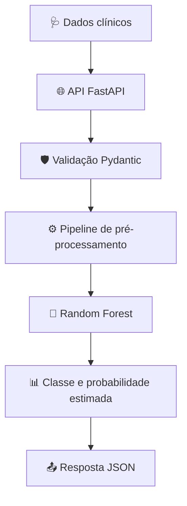
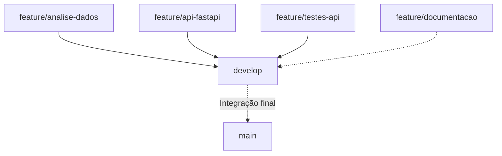

# 🫀 CardioPredict Clínico

### Inteligência Artificial aplicada à classificação experimental de doença cardíaca


> 🎓 **Projeto educacional — SENAI**
>
> Sistema experimental que integra Ciência de Dados, Machine Learning e desenvolvimento de APIs para classificar a presença ou ausência de doença cardíaca com base no conjunto de dados Cleveland.

**⚠️ Aviso importante:** o CardioPredict Clínico não é um dispositivo médico validado. Seus resultados não devem ser utilizados para diagnóstico, tratamento ou decisões clínicas reais.

---

## 📑 Sumário

1. [Visão geral](#-visão-geral)
2. [Arquitetura do sistema](#-arquitetura-do-sistema)
3. [Tecnologias](#-tecnologias)
4. [Base de dados](#-base-de-dados)
5. [Modelo de Machine Learning](#-modelo-de-machine-learning)
6. [Resultados do modelo](#-resultados-do-modelo)
7. [Estrutura do projeto](#-estrutura-do-projeto)
8. [Instalação](#-instalação)
9. [Executando a API](#-executando-a-api)
10. [Testes automatizados](#-testes-automatizados)
11. [Versionamento Git](#-versionamento-git)
12. [Limitações](#-limitações)
13. [Próximas melhorias](#-próximas-melhorias)

---

## 🎯 Visão geral

O **CardioPredict Clínico** foi desenvolvido para demonstrar como técnicas de aprendizado supervisionado podem ser integradas a uma aplicação web por meio de uma API REST.

### Principais funcionalidades

- 🧠 Classificação binária com Random Forest.
- 📊 Pré-processamento automatizado de dados.
- 🩺 Recebimento de 13 características clínicas.
- ⚡ Previsões disponibilizadas por FastAPI.
- 🛡️ Validação de dados com Pydantic.
- 🧪 Testes automatizados com pytest.
- 📖 Documentação interativa com Swagger.
- 🔀 Controle de versões utilizando Git e GitHub.

## 🏗️ Arquitetura do sistema



O pipeline treinado é carregado na inicialização da aplicação e reutilizado durante as requisições.

## 🛠️ Tecnologias

| Tecnologia | Finalidade |
|---|---|
| 🐍 Python | Desenvolvimento |
| 🐼 pandas | Manipulação dos dados |
| 🔢 NumPy | Operações numéricas |
| 🤖 scikit-learn | Machine Learning |
| 💾 joblib | Persistência do pipeline |
| ⚡ FastAPI | API REST |
| 🛡️ Pydantic | Validação de entradas |
| 🚀 Uvicorn | Servidor ASGI |
| 🧪 pytest | Testes automatizados |
| 🔀 Git/GitHub | Versionamento e Pull Requests |

## 🗂️ Base de dados

O projeto utiliza a base **Cleveland Heart Disease**, disponível no UCI Machine Learning Repository.

🔗 [Consultar a base original](https://archive.ics.uci.edu/dataset/45/heart+disease)

| Característica | Informação |
|---|---|
| Registros | 303 |
| Variáveis preditoras | 13 |
| Problema | Classificação binária |
| Variável original | `num` |
| Classe 0 | Ausência de doença cardíaca na codificação do conjunto |
| Classe 1 | Presença de doença cardíaca na codificação do conjunto |

### 🩺 Variáveis utilizadas

| Variável | Significado |
|---|---|
| `age` | Idade |
| `sex` | Sexo codificado |
| `cp` | Tipo de dor torácica |
| `trestbps` | Pressão arterial sistólica em repouso |
| `chol` | Colesterol sérico |
| `fbs` | Indicador de glicemia de jejum elevada |
| `restecg` | Categoria do ECG em repouso |
| `thalach` | Frequência cardíaca máxima |
| `exang` | Angina induzida por exercício |
| `oldpeak` | Depressão do segmento ST |
| `slope` | Inclinação do segmento ST |
| `ca` | Vasos principais visualizados por fluoroscopia |
| `thal` | Categoria do exame de perfusão |

## 🧠 Modelo de Machine Learning

Foram avaliados modelos de classificação supervisionada, incluindo Regressão Logística e Random Forest.

O modelo selecionado foi **Random Forest**, utilizando 200 árvores e balanceamento de pesos das classes.

### Etapas de processamento


O processamento inclui imputação pela mediana para variáveis numéricas, imputação pela moda para categóricas, `StandardScaler` e `OneHotEncoder`.

## 📈 Resultados do modelo

### Desempenho no conjunto de teste

| Métrica | Resultado |
|---|---:|
| 🎯 Acurácia | **81,97%** |
| 🔍 Precisão | **79,31%** |
| ❤️ Sensibilidade | **82,14%** |
| 🛡️ Especificidade | **81,82%** |
| ⚖️ F1-score | **80,70%** |
| 📈 ROC-AUC | **92,48%** |

### Matriz de confusão

| | Predição negativa | Predição positiva |
|---|---:|---:|
| Real negativo | 27 | 6 |
| Real positivo | 5 | 23 |

Esses indicadores representam resultados experimentais obtidos no conjunto de teste. Não comprovam desempenho em ambientes clínicos reais.

## 📁 Estrutura do projeto

```text
CardioPredict-AI/
│
├── app/
│   ├── main.py
│   ├── routers/
│   │   ├── health.py
│   │   └── predict.py
│   ├── schemas/
│   │   └── prediction.py
│   └── services/
│       └── predictor.py
│
├── models/
│   └── cardiopredict_pipeline.joblib
│
├── notebooks/
│   └── 01_analise_exploratoria.ipynb
│
├── reports/
│   └── metricas_modelo.json
│
├── scripts/
│   └── treinar_modelo.py
│
├── tests/
│   ├── README.md
│   ├── README_PREDICT.md
│   ├── test_health.py
│   └── test_predict.py
│
├── requirements.txt
└── README.md
```

## 💻 Instalação

### 1. Clonar o repositório

```powershell
git clone https://github.com/MarcioPaiano/CardioPredict-AI.git
cd CardioPredict-AI
```

### 2. Criar ambiente virtual

```powershell
python -m venv .venv
```

### 3. Ativar ambiente virtual

```powershell
.\.venv\Scripts\Activate.ps1
```

### 4. Instalar dependências

```powershell
python -m pip install -r requirements.txt
```

**Observação:** enquanto a branch de desenvolvimento não for integrada à `main`, utilize a branch `develop` para acessar a implementação mais recente:

```powershell
git switch develop
```

## 🚀 Executando a API

Inicie o servidor:

```powershell
python -m uvicorn app.main:app --reload
```

### Endereços locais

| Recurso | Endereço |
|---|---|
| 🏠 API | http://127.0.0.1:8000 |
| 📖 Swagger | http://127.0.0.1:8000/docs |
| 📚 ReDoc | http://127.0.0.1:8000/redoc |
| ❤️ Health | http://127.0.0.1:8000/health |

A raiz `/` não possui necessariamente uma rota implementada. A documentação interativa é acessada em `/docs`.

### ❤️ GET /health

Verifica se o modelo está disponível.

```json
{
  "status": "ok",
  "modelo_carregado": true
}
```

### 🧠 POST /predict

Exemplo de requisição:

```json
{
  "age": 58,
  "sex": 1,
  "cp": 4,
  "trestbps": 140,
  "chol": 245,
  "fbs": 0,
  "restecg": 0,
  "thalach": 150,
  "exang": 1,
  "oldpeak": 2.3,
  "slope": 2,
  "ca": 1,
  "thal": 7
}
```

Exemplo ilustrativo de resposta:

```json
{
  "classe_prevista": 1,
  "probabilidade_presenca": 0.82
}
```

A probabilidade real é calculada pelo modelo e pode diferir do exemplo.

### 🛡️ Códigos HTTP

| Código | Significado |
|---|---|
| 200 | Previsão realizada |
| 400 | Regra operacional violada |
| 422 | Dados inválidos |
| 500 | Falha interna na previsão |
| 503 | Modelo indisponível |

## 🧪 Testes automatizados

O projeto possui sete testes automatizados.

| Arquivo | Testes |
|---|---:|
| `test_health.py` | 2 |
| `test_predict.py` | 5 |
| **Total** | **7** |

Para executar:

```powershell
python -m pytest tests/ -v
```

Resultado obtido durante o desenvolvimento:

```text
7 passed, 1 warning
```

### 📚 Documentação dos testes

- [Testes do endpoint Health](tests/README.md)
- [Testes do endpoint Predict](tests/README_PREDICT.md)

## 🔀 Versionamento Git

O desenvolvimento utiliza uma estratégia de branches:



A branch `develop` concentra as funcionalidades integradas e a branch `main` será utilizada para a versão final consolidada.

As branches de funcionalidades são preservadas para manter o histórico do desenvolvimento.

## ⚠️ Limitações

- Base de dados pequena e histórica.
- Ausência de validação clínica externa.
- Ausência de validação prospectiva.
- Possibilidade de falsos positivos e falsos negativos.
- Probabilidades sem calibração clínica demonstrada.
- Não estima diretamente o risco futuro de infarto.
- Não substitui avaliação médica.

## 🔭 Próximas melhorias

- Ampliar os cenários de testes automatizados.
- Avaliar calibração das probabilidades.
- Investigar desempenho em bases externas.
- Adicionar integração contínua para execução dos testes.
- Aprimorar a apresentação e a documentação do projeto.

---

### 🎓 Projeto educacional SENAI

**CardioPredict Clínico — Machine Learning + FastAPI + Python**

Desenvolvido para demonstrar conhecimentos de ciência de dados, programação, APIs, validação, testes e versionamento de software.

**🫀 Tecnologia aplicada ao aprendizado, com responsabilidade na interpretação dos resultados.**